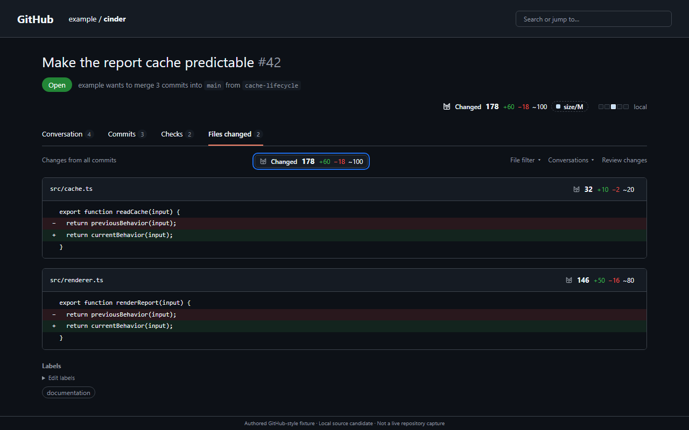
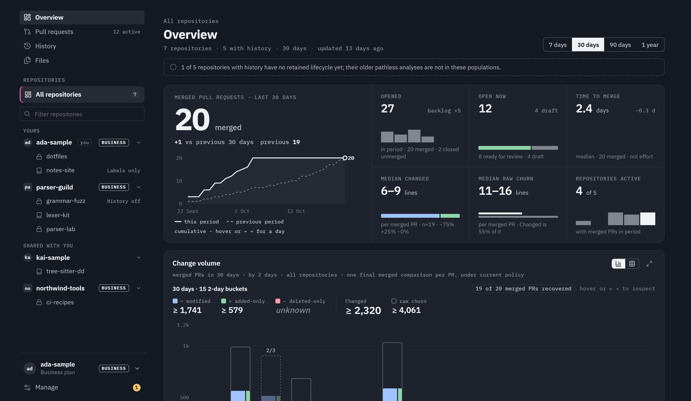

<h1>
  <picture>
    <source media="(prefers-color-scheme: dark)" srcset="brand/bundle/diffdevil/assets/lockup-default/on-dark.svg">
    <source media="(prefers-color-scheme: light)" srcset="brand/bundle/diffdevil/assets/lockup-default/on-light.svg">
    
  </picture>
</h1>

[](https://www.npmjs.com/package/@wolfsblvt/diffdevil)
[](https://github.com/Wolfsblvt/diffdevil/actions/workflows/verify.yml)
[](https://github.com/marketplace/actions/diffdevil)
[](https://docs.diffdevil.dev/start/analyze-local-changes/)
[](https://docs.diffdevil.dev/)

> **The devil is in the diff.**

**Measure changes. Match rules. Act on the result.**

diffdevil helps you understand what changed in a pull request, use those facts in
automation, and follow how a codebase changes over time. One engine powers a
personal browser extension, free open tools, and a managed App for repository
history and automation.

Replace three adjacent lines and diffdevil counts **3 Changed**, while preserving
Git's **6 lines of raw churn**. You can see the breakdown, decide which files matter,
and reuse the same measurements in your own rules. Missing evidence stays visible;
it never becomes an invented zero. [How the counting works](https://docs.diffdevil.dev/understand/changed-lines-and-churn/).

**[Explore the website](https://diffdevil.dev/)** ·
**[Try Lens Studio](https://diffdevil.dev/playground/)** ·
[Documentation](https://docs.diffdevil.dev/) · [Quick start](#run-the-open-tools)

The **CLI, TypeScript library and four GitHub Actions are released**. The extension
is in Chrome Web Store preparation; the App is in private preview, with public
installation and paid plans still to come. Lens Studio and the
[real-PR Examples](https://diffdevil.dev/examples/) let you explore without an account.

## See Changed inside GitHub

**diffdevil for GitHub** puts Changed beside the pull request and each file.
Click it to inspect the breakdown, included files, size bands, and the policy
behind the result. Use your own preferences or the repository's configuration.

No workflow, App installation, or repository write access is needed. The extension
measures in your browser using your existing GitHub access. It changes your view;
the App runs for the repository.



*Actual extension UI on an authored example pull request; this is a fixture, not a live repository capture.*

**[Explore the extension](https://diffdevil.dev/extension/)** for Store availability,
or [build it from source for Chrome](https://docs.diffdevil.dev/use/browser-extension/).
The guide covers supported browsers, permissions, cached reports and private-repository handling.

## Give your repository a memory

The **managed App** brings pull requests, repository history, and file history into
one place. Follow how changes reach merge, explore where work accumulates, and
trace files through growth, repeated edits, and changes made together. The same
policy can run checks, maintain labels, and keep a configured PR comment up to date.



*Actual App UI with sample accounts and fixture data.*

The planned hosted offer has **Free** for PR operation and basic repository
history, **Pro** for deeper file history and context, and **Business** for shared
policies and delegated administration. There are **no paid reader seats**: people
with current GitHub access can read a connected repository's funded capabilities.
Public installation and paid enrollment are not open yet.

History collection is explicit. Retained history includes measurements, paths,
and comparison metadata, **not source code or patch contents**. Counts describe
change, not code quality, risk, or people's performance.

**[Explore the App](https://diffdevil.dev/app/)** ·
[Read repository history](https://docs.diffdevil.dev/use/managed-app/read-history/) ·
[Plans and shared access](https://docs.diffdevil.dev/use/managed-app/plans-and-sharing/)

Prefer to operate it yourself? [Community self-hosting](https://docs.diffdevil.dev/use/managed-app/self-hosting/)
has its own setup and operating responsibilities; premium modules are separately licensed.

## Run the open tools

The **CLI, library and Actions are complete free tools**. No diffdevil account or
hosted subscription is required. Start locally with **Node.js 22 or later** and npm:

```sh
npm install --save-dev @wolfsblvt/diffdevil
npm exec -- diffdevil analyze --diff-file node_modules/@wolfsblvt/diffdevil/docs/examples/diffs/review.diff --no-config --preset size@1 --format human
```

The packaged example reports **10 Changed**, **16 raw churn**, and **4 files**.
It separates additions, deletions and modifications; `--no-config` keeps this
first run independent of your repository's policy. No labels or comments are written.

In a Git repository, inspect your own tracked working changes:

```sh
npm exec -- diffdevil analyze --format human
```

[The local guide](https://docs.diffdevil.dev/start/analyze-local-changes/) covers
staged changes, branch comparisons, configuration, and an empty or unexpected result.

| What you want to do | Your next step |
| --- | --- |
| Keep pull-request size labels up to date | [Add one workflow](https://docs.diffdevil.dev/start/label-pull-requests/). Requires permission to add a workflow and write PR labels; the default posts no comment. |
| Feed a script or gate a change | [Query values, select files, or check a condition](https://docs.diffdevil.dev/start/use-results-in-scripts/), with distinct results for false, failure and unresolved evidence. |
| Define what matters to your repository | [Start with a preset](https://docs.diffdevil.dev/policy/), then add scopes, metrics, bands and rules in YAML or JSON. |
| Embed the engine in your application | [Use the TypeScript library](https://docs.diffdevil.dev/use/typescript-library/). |
| Give a coding agent the same facts | [Install the agent Skill](https://docs.diffdevil.dev/use/coding-agent/) and connect it to the CLI. |

Analysis, an effect plan, and an applied change are separate steps. Inspect the
plan before applying it; incomplete evidence stays explicit throughout.
[Reports, plans and apply](https://docs.diffdevil.dev/use/reports-plans-and-apply/)
explains the boundary.

## Learn more and contribute

The **[manual](https://docs.diffdevil.dev/)** explains each route, from first use to
the exact interfaces. The [FAQ](https://diffdevil.dev/faq/) answers common questions;
[Releases](https://docs.diffdevil.dev/help/releases/) separates package, Action,
extension and App availability.

For source work, start with [Development](docs/DEVELOPMENT.md) and the
[repository documentation map](docs/README.md). Read
[Security and data](https://docs.diffdevil.dev/help/security-and-data/) before sharing
a report. Use the [private security route](SECURITY.md) for suspected vulnerabilities.

## Made by Wolfsblvt Works

<a href="https://wolfsblvt.works/">
  <picture>
    <source media="(prefers-color-scheme: dark)" srcset="vendor/brand/works/assets/lockup-compact/on-dark.svg">
    <source media="(prefers-color-scheme: light)" srcset="vendor/brand/works/assets/lockup-compact/on-light.svg">
    
  </picture>
</a>

diffdevil is a [Wolfsblvt Works](https://wolfsblvt.works/) product.
[Support the work](https://github.com/sponsors/Wolfsblvt) if it earns a place in yours.

## License

[Licensing by component](LICENSE.md): **MIT** for the reusable engine, CLI, library and Actions;
**AGPL-3.0-only** for application/service software; **CC BY 4.0** for original documentation,
with brand and visual rights reserved and component-specific terms in [LICENSES](LICENSES/README.md).
