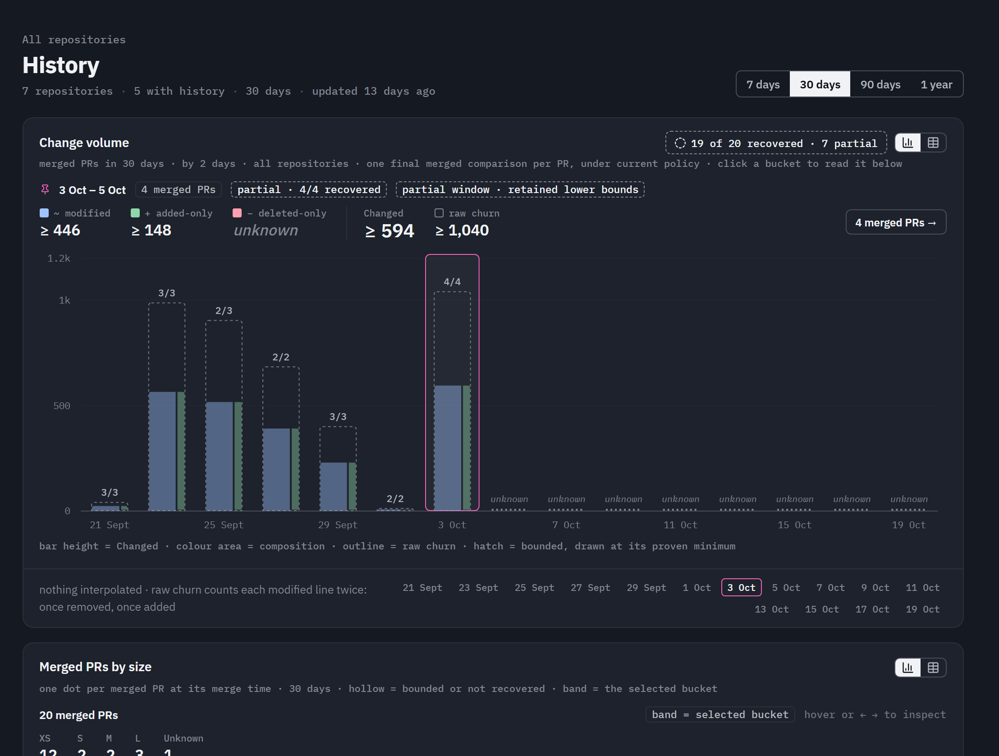

# Read repository history

> [!NOTE]
> **In development**
>
> These analytical views are implemented and locally qualified. Public App access, real repository collection and the complete live customer journey remain separate delivery steps.

Use the App to follow a change from repository activity into a pull request or a file's history. Start with the scope, period and coverage; then follow a chart or list to the observations behind it. You can read a connected repository without administering it or buying a reader seat, provided you have current GitHub access. [Plans and shared access](plans-and-sharing.md) explains which capabilities that scope supplies.

## Choose a scope and period

Select **All repositories**, a personal or organization namespace, or one repository. The selected period follows you between the analytical destinations. A namespace shows its funded capabilities; All repositories uses your own plan for premium aggregates and includes only eligible repositories. A missing entitlement, unreadable history or incomplete inventory is stated as a limit on the view, not counted as zero.

A direct repository, PR or file link checks your current GitHub access to that exact connected repository. It can work even when the repository did not appear in ordinary discovery. Continuing into its namespace can preserve that one authorized target, with a partial-inventory notice; it does not discover private siblings or silently add them to All repositories. A link is a destination, not a lasting access grant.

Read the coverage beside a result before comparing periods. The date range you selected is not proof that the App recovered every PR in it. History collected after opt-in, imported comparisons, paused intervals and unrecoverable revisions can produce different coverage.

## Find the right destination

| View | Start here when you want to… | Follow through to… |
| --- | --- | --- |
| **Overview** | Understand merged-PR activity, size mix and what changed from the previous period | A repository, an active PR or the contributing population |
| **Pull requests** | Inspect flow, lifecycle, size and analyzed-head development, then search or filter the PR list | One PR and its actual comparison |
| **History** | Compare Changed and its composition over time | A time bucket and the merged PRs contributing to it |
| **Files** | Explore which files change often, by how much and alongside which other files | A repository-qualified file and its history; this is a premium view |
| **PR detail** | Read a PR's facts, evidence, policy and desired versus observed effects | Its files, recorded heads and eligible historical context |
| **File detail** | Understand one file's frequency, volume, size, Turnover and co-change | The merged PRs behind those measurements; this is a premium view |

**Manage** is separate from these analytical destinations. It holds repository selection, settings, processing and funding. A read-only collaborator does not need those controls to inspect available history.

## Read a chart without losing its evidence

This is a retained capture of the built App on its sample fixture, not a live customer's history. In the selected bucket, four recovered comparisons still have partial line evidence: recovering a comparison and measuring every line exactly are different facts.

In the change-volume chart, bar height represents **Changed**. Its colored areas separate modified, added-only and deleted-only lines; the outline shows raw churn at its own scale. Select a mark or use the keyboard controls to read its values and follow the contributing PRs. The table view exposes the same observations when a chart is not the useful way to read them.

Ranges remain ranges. Partial acquisition can establish only a lower bound, and unknown values or missing history stay visible. Unknown size bands do not disappear into the smallest band. [Evidence and uncertainty](../../understand/evidence-and-uncertainty.md) explains how a decision can sometimes resolve even when a count remains bounded.

Most repository and file history uses **one final recoverable comparison per merged PR**, placed by merge time. It does not sum every evolving PR head or claim to measure direct pushes and all branch activity. Pull-request flow also includes its explicitly named opened population; current activity and related work use open PRs. Observation time and import time are not substitutes for the event's time.

Lifecycle durations describe elapsed time between known events. They do not measure development effort, review labor or a person's speed. Missing transitions cannot establish a zero-duration stage.

## Inspect a pull request

Open a PR from a chart, the PR list or a brief link. First match its repository, PR number and immutable comparison. Freshness states whether that analyzed head is still current. Then read the measured facts, included and excluded files, policy interpretation and GitHub outcomes separately.

The ordinary historical view uses the current effective policy after recalculation. While a refresh is pending, read the displayed policy basis. An original merge-time result is available only when it was actually recorded; an imported PR or a policy hash cannot reconstruct a missing original result. Changing today's policy does not rewrite a label or comment that GitHub received in the past.

The file list preserves excluded observations so you can see what the policy left out. Their paths and numerical facts can support a later policy replay. Excluding a file from analytics is not an instruction to avoid collecting its permitted measurements. [Security and data](../../help/security-and-data.md#opt-in-quantitative-history) owns that distinction.

Head-by-head PR development is a separate view of the PR's evolution. Its revisions are not extra merged PRs. Base measurements remain useful while optional premium file context is pending.

## Follow a named file safely

Files are identified visibly by repository and relative path, so two repositories' `src/index.ts` entries are distinguishable. The file-detail URL uses an opaque handle. The path is not placed in that URL or its document title; copying or bookmarking the link still requires current authorization when it is opened. The visible page and an authorized export can contain protected paths.

File continuity follows observed rename relationships and immutable comparisons. The same spelling reused later does not prove the same historical file. Missing revisions, deletion, binary material and identity gaps limit what can be reconstructed.

The default file-cloud weight is **frequency**: distinct merged PRs touching the file during the selected period. Changed volume, raw churn and Turnover answer different questions. A large word is a navigation and comparison aid, not a risk or importance score.

**Turnover** is Changed in the period divided by the file's time-weighted average size during that period, displayed as a multiple such as `1.8×`. It can exceed one and does not mean that 180% of unique lines were rewritten. Bounded Changed gives a range. A file created or deleted during the period shows `n/a`; missing, binary or zero-size evidence cannot supply an invented denominator. This definition is for files, not a repository-wide ratio.

Co-change shows files observed together, with sample context and contributing PRs. It does not establish causality or a missing-test diagnosis. Another open PR touching the same file does not prove overlapping line positions or a merge conflict.

## Understand a PR brief

An optional App brief brings selected context back to GitHub and links to PR detail. When the size report is enabled, the context joins that same owned comment. It can show current same-file work, eligible historical file measurements and an evidenced companion. Selection is deterministic; it does not use a language model or review the correctness of the code.

The basic size report stays useful without premium context. Historical companions are observations to consider, not instructions to edit another file. Brief controls and preview belong to the repository's App settings; they do not introduce another `.diffdevil.yml` language.

The App refreshes eligible open replies for relevant changes and does not keep rewriting closed or merged replies. A final merge summary is a separate explicit option. Importing history never posts retroactive comments or labels.

## When history is missing

Check the selected scope, current GitHub access, history standing, recovered coverage and feature entitlement. A repository may be reachable without history, funded without readable measurements, or partly imported. None means that no changes occurred. Older pathless records cannot supply missing filenames.

For imports, pauses, retries and recalculation, use [Manage in the service guide](service.md#inspect-and-extend-history). A larger plan or resumed collection does not silently recreate deliberately deleted intervals. The [analytical contract](../../../dashboard.md) owns the full measurement and population definitions; [Releases](../../help/releases.md) distinguishes implemented source from the App actually available to you.
