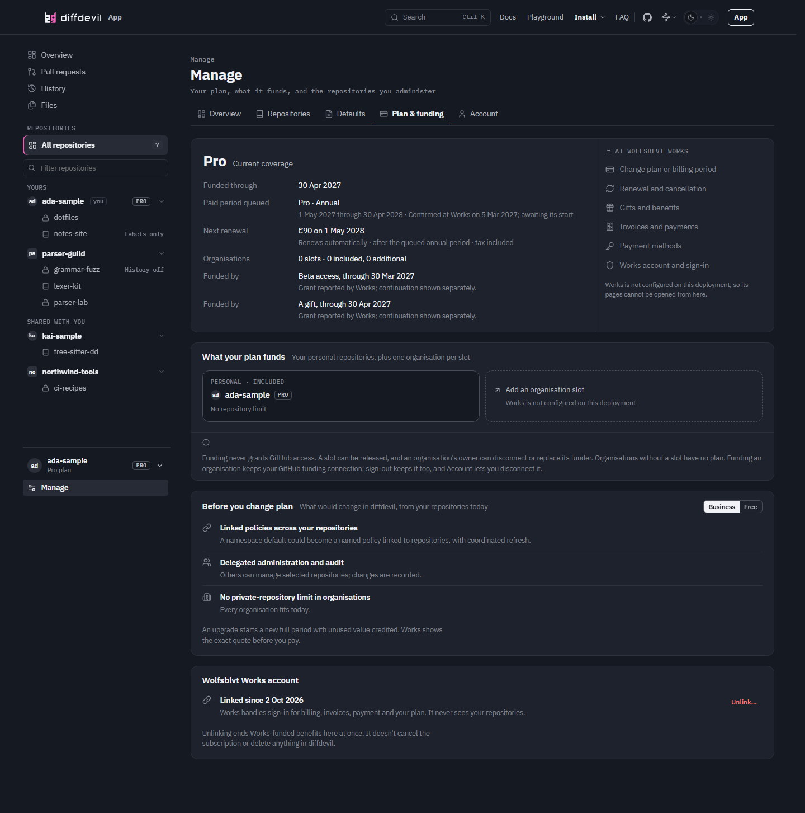
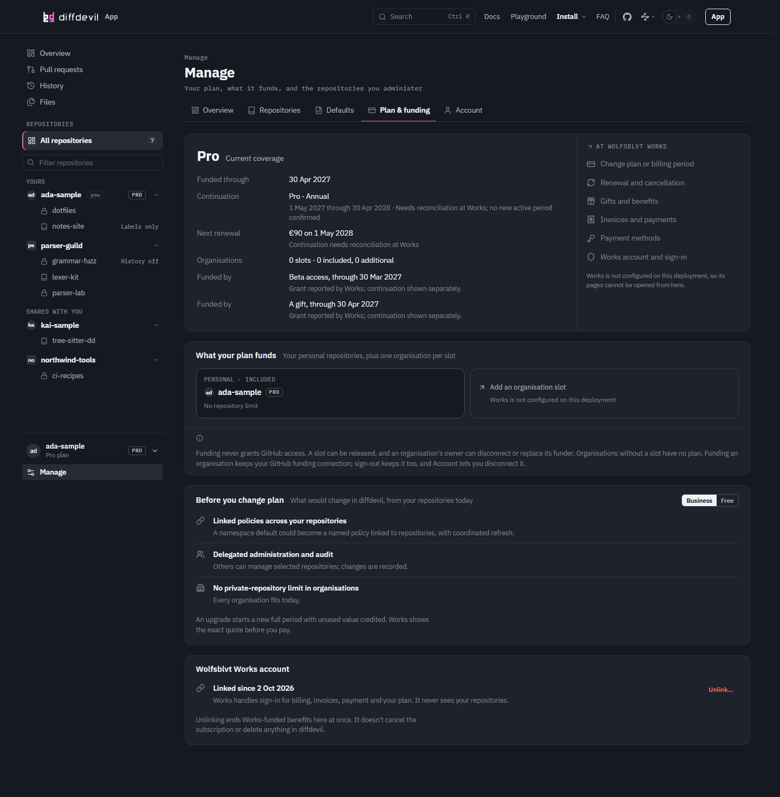
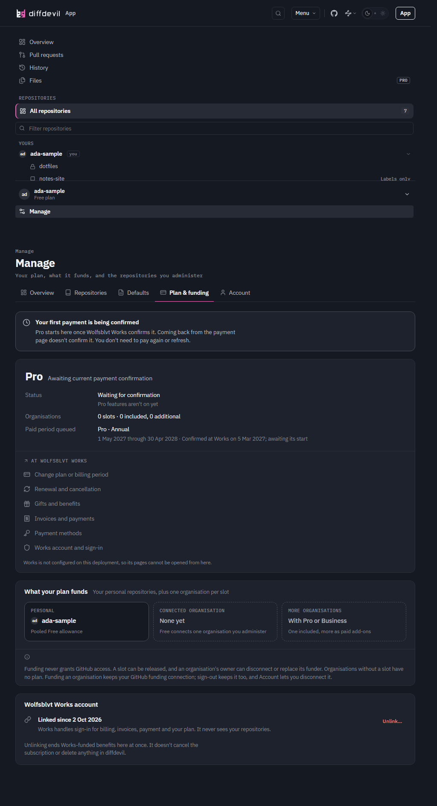

# Queued coverage consumer qualification

## Meaning

This dated local qualification shows current beta/gift coverage, a confirmed queued
full paid year and its supplied later renewal together in the existing Plan &
funding card. It preserves rendered and machine-readable evidence for the public
consumer repair, including reconciliation, missing facts and refused updates.
Every account, date, amount and signed message is synthetic. It establishes no
installed Wirt/App compatibility, commercial acceptance, payment or deployment.

## Source and result

The candidate extends public base `5d6d990c1a918c5fd2f0bbad69744a97b07c22a2`.
The projection reader, authenticated commercial status and existing Manage
presenter carry only Wirt's public queued-term fields. Current entitlement still
comes from current commercial standing. Works owns all arithmetic, confirmation,
activation and commercial detail.

`npm run app:build` passed for Community. The focused browser command
`node apps/app/qa/run.mjs --queued-coverage` passed **23/23** checks through the
built Worker, signed receiver, local D1, real session/status boundary and headless
Chromium with the repository's GitHub double. Console errors, page errors and
external requests were all zero. The focused pure reader/presenter tests passed
**4/4**; the commercial/Manage/queued regression suites passed **63/63** before
the final pending-payment subtitle clarification, which was then exercised by
the pure tests and final browser pass. Hosted results belong to the exact PR head.

The [browser results](2026-10-26-queued-coverage/results.json) preserve every check.
The native Works links remain disabled in this receiver specimen because no Works
origin or OAuth client is configured; this is an unavailable destination, not
evidence of a Works customer journey. Existing configured exits are unchanged.

## Rendered states

The synthetic current grants precede a supplied annual period from 1 May 2027
through 30 April 2028; the supplied next renewal is €90 on 1 May 2028. The App
derives no start, end, anchor or amount from the grants.

A held continuation retains its dates as supplied and explicitly requires
reconciliation without claiming a new active period.

A queued paid term does not confirm a current pending payment. The compact-desktop
capture also qualifies the definition rows without horizontal overflow.

The pass also rendered benefit-funded continuation, absent legacy continuation and
unavailable renewal facts. Malformed future dates and a mismatched signed account
were refused while the previous applied view survived. Real provider authority,
installed producer/consumer agreement, gift issuance, earning and ordinary use
remain separate qualification.
